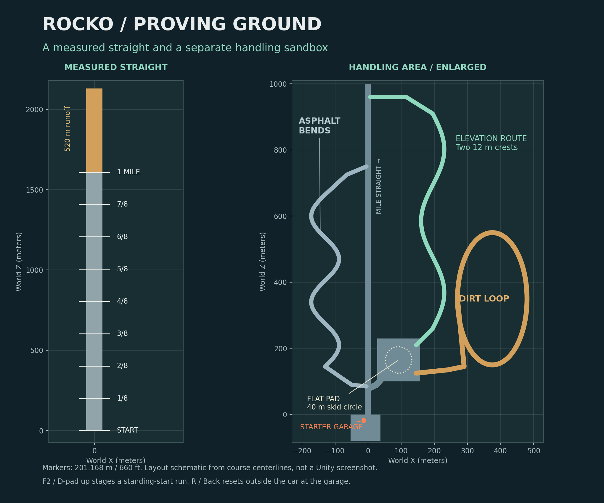

# 🚗 Rocko — Unity driving prototype 0.1

### Follow-up: synchronization in both clutch modes

The clutch torque solver now accounts for both engine inertia and the finite driveline load. The earlier solver pulled engine speed toward a sampled shaft speed as though the shaft could not accelerate, while simultaneously applying torque that changed that shaft speed. This could produce repeated speed corrections in either clutch mode.

The reflected load estimate includes wheel rotational inertia and chassis mass coupled through grounded tires; chassis coupling fades with tire slip. This remains an approximate coupling to Unity's separate WheelCollider solver and needs Unity runtime validation. Engine speed is still integrated from torque: the HUD lock threshold is unchanged, with no forced RPM matching or permanent lock flag.

New EditMode tests check synchronization and angular momentum with multiple load inertias and changing torque. Two new PlayMode tests exercise assisted and manual launches, then require the RPM gap to stay below 80 RPM and the clutch to stay locked on **every rendered frame for two seconds**. The old smoke test only observed at least one locked tick, so passing it did not establish sustained lock. Run the new tests after updating; they have not been executed in Unity in the authoring environment.

### Follow-up: clutch remains slipping

Launch assistance now blends into full clutch pressure between idle + 100 and idle + 900 engine-equivalent RPM, calculated from actual road speed. At the upper threshold, launch assistance ends. It re-arms only when both road-equivalent and gearbox RPM fall below idle + 100, so engine flare or tire slip alone cannot reopen the clutch while driving. Gear changes remain manual and the clutch pedal still overrides assistance.

The diagnostics panel includes clutch engagement percentage and engine/gearbox RPM difference. During **F2 → Shift → hold W**, expect initial launch slip, then **100%** clutch pressure and a small RPM gap. Full pressure does not by itself prove synchronization. The Unity smoke test now requires actual clutch lock during launch and sustained full pressure afterward. Unity execution is still pending in the authoring environment.

### Follow-up: engine revs but the car stays still

Rolling resistance now acts as a force opposing chassis motion, instead of continuously applying WheelCollider brake torque. At rest it applies no force; at very low speed it is capped so it cannot reverse the car. Wheel brakes are reserved for the service pedal and parking/handbrake. Manual gear selection and the existing clutch model are unchanged.

The driving HUD now shows grounded wheel count, both front wheel RPMs, representative front/rear brake torques, and throttle/brake input. Check **F2 → Shift → hold W**: expect contact **4/4**, throttle **100%**, brake **0%**, brake torque **0 / 0**, and rising wheel RPM/speed. Repeat after stopping with S and releasing it. Unity runtime verification is still required; the included tests cover brake release during launch and rolling resistance direction/limits.

### Driving and world-text fix

- Configure chassis mass before creating WheelColliders, then recalculate suspension loads after the final center-of-mass setup.
- Wake a sleeping parked car when driving or shifting input arrives.
- Render world labels with depth testing and fog, before the windscreen glass. Buildings, the car body, and sign boards now occlude these labels; the HUD remains a screen overlay.
- Keep the neutral/first-gear instruction visible after the temporary reset notice expires.

Quick check: open **Rocko → Open Prototype Scene**, press Play, then **F2 → Shift → W**. F2 seats you at the straight; Shift selects first gear; W accelerates. Inspect road signs from inside the garage and behind sign boards to check occlusion. Run the PlayMode smoke test for tire contact, supported mass, launch from a sleeping chassis, and braking. These changes have not been run in Unity in the authoring environment.

A first-person Scirocco II sandbox focused on developing the driving model before adding car building or survival systems.

**Delivery status:** Unity project source, not a compiled game. C# syntax and project wiring were checked here. Unity is not installed in the authoring environment, so compilation, shaders, controller hardware, driving performance, and visual appearance have **not** been verified in the Unity Editor. The included Unity tests still need to be run.

## Open and drive

1. Extract this archive into a normal writable folder, such as `C:\Projects\Rocko`.
2. In **Unity Hub → Projects → Add**, select the **Rocko** directory containing `Assets`, `Packages`, and `ProjectSettings`.
3. Open with **Unity 6.0 / 6000.0**. The project version file uses `6000.0.23f1` as its API baseline; you can select your installed 6000.0 patch in Hub. Allow package restoration and any Input System restart prompt.
4. Open **Assets → Rocko → Scenes → Rocko**, or use **Rocko → Open Prototype Scene**.
5. Press **Play**, then click the Game view. The world and car are generated at runtime, so the scene is intentionally almost empty before Play.
6. You start on foot in the garage, beside the driver's door. Press **E**, then **Shift** for first gear. Use **W** to accelerate, **S** to brake, and **A/D** to steer. Look around with the mouse.

The project uses Unity's **Built-in Render Pipeline**. Do not convert it to URP/HDRP without replacing its two surface shaders. No Asset Store purchase or external vehicle model is required.

## Controls

Controller labels below use Xbox names. PlayStation equivalents are Cross = A, Circle = B, Square = X, Triangle = Y, R1 = RB, and L1 = LB.

| Action | Keyboard / mouse | Controller |
|---|---|---|
| Walk | WASD | Left stick |
| Look | Mouse | Right stick |
| Enter / exit car | E | A |
| Throttle | W | RT |
| Service brake | S | LT |
| Steer | A / D | Left stick X |
| Gear up | Shift | RB |
| Gear down | Ctrl | LB |
| Disengage clutch | Hold C | Hold X |
| Handbrake | Hold Space | Hold B |
| Restart stalled engine | I | Y |
| Reset outside car at garage | R | Back / Share |
| Stage straight test, seated | F2 | D-pad up |
| Toggle clutch assistance | F3 | D-pad left |
| Start / stop CSV recording | F5 | D-pad right |
| Toggle help | F1 | D-pad down |
| Center view | V | Press right stick |
| Pause / release mouse | Esc | Start / Options |

**Manual transmission only:** the sequence is **R → N → 1 → 2 → 3 → 4 → 5**. There are no automatic gear changes. From neutral, Ctrl selects reverse. W is the accelerator in reverse as well; S always brakes.

**Clutch assistance starts enabled.** It operates the clutch during launch and your requested shifts. For full clutch operation, press F3, hold C to select a gear, apply throttle, then release C. The digital keyboard clutch is smoothed but is still a binary input; controller X is also a button, not an analog pedal. The engine can stall. Over-rev downshifts and moving reverse selection are blocked as prototype usability guards.

## Included

- One gameplay camera: on-foot first person and seated first person. No chase camera.
- Driver-side proximity entry; stationary exit checks for ground and capsule clearance on either side.
- Runtime Scirocco-inspired blue body, wheel arches, rectangular lights, black trim, alloy spokes, sloping hatch, spoiler, and provisional left-hand-drive interior.
- FWD, a five-speed manual, separate engine speed, clutch capacity/slip, engine braking, idle control, rev limiter, and stalling.
- Four WheelColliders with suspension, damping, estimated anti-roll bars, Ackermann steering, drag, rolling resistance, and surface-dependent tire friction.
- Every requested HUD channel, plus lateral G, clutch status, tire slip in CSV, standing-start splits, and local telemetry recording.
- A mile straight, eighth-mile markers, 520 m braking runoff, flat skidpad/slalom, asphalt corners, two hill crests, dirt loop, and starter garage.
- A synthesized engine sound placeholder. It is not a recording of an EA827.

## Specification baseline

The supplied `Car-specs.txt` is the mechanical authority. The supplied photographs guide the appearance; their GT II/GTX trim differences are not treated as mechanical specifications.

| Item | Supplied value / treatment |
|---|---|
| Engine | 1.8 L EA827 16V inline four |
| Drive / gearbox | Front-wheel drive / five-speed manual |
| Peak crank torque | 165 Nm at 4,600 rpm |
| Rated crank power | 102 kW at 6,100 rpm |
| Curb mass | 950 kg |
| Wheelbase | 2.400 m |
| Body length × width × height | 4.050 × 1.625 × 1.280 m |
| Stated top speed | Approximately 210 km/h / 131 mph, a validation target, not a speed cap |

102 kW is about **136.8 mechanical hp**, or roughly **139 PS**. It is **crank** power. The provisional 88% drivetrain efficiency implies about **120.4 wheel hp** at the engine's rated power point with a locked clutch. This is an estimate, not a measured dyno result.

The simulation currently uses **1,025 kg operating mass**, including a fixed 75 kg driver allowance even while the player is outside. The 950 kg curb specification remains separate in the tune.

**Unverified settings:** gearbox ratios, final drive, tire size, redline, torque-curve intermediate points, clutch capacity/inertia, suspension, center of mass, aerodynamic drag, and grip. See [the calibration notes](Documentation/PHYSICS.md). The body dimensions are a fixed modeling baseline; changing dimension fields alone does not regenerate a differently shaped car.

## Test grounds

The start stripe is at world **Z = 0**; the end-of-mile stripe is at **Z = 1609.344 m**. Each eighth-mile interval is exactly **201.168 m / 660 ft**. The road is flat, 16 m wide, and continues another 520 m for braking. F2 places the car eight meters before the stripe, facing forward.

Timing uses a **standing start from the F2 staging position**, not a rolling crossing of the painted start stripe. Distances are measured from that staging origin, so timing thresholds fall eight meters before the corresponding physical track markers. No rollout correction is applied. Leaving the straight invalidates the run. The displayed quarter-mile finish speed is instantaneous speed at the distance threshold, not a drag-strip averaged trap speed.

## HUD definitions

| Channel | Meaning |
|---|---|
| Gear | Selected R, N, or 1–5; changes after the shift interval |
| Speed / mph | Magnitude of rigid-body world velocity |
| Engine / RPM | Simulated crank rotational speed; not simply speed multiplied by gear ratio |
| Acceleration / G | Smoothed kinematic acceleration along the car's forward axis; negative under deceleration |
| Wheel output / hp | Signed power delivered to the driven axle: axle torque × mean front-wheel angular velocity |
| Axle torque / lb-ft | Total signed torque delivered to both front wheels after gearing and modeled losses |
| Crank torque / lb-ft | Net engine torque before clutch/transmission, displayed beneath axle torque |

Axle torque is much larger than crank torque in low gears. Torque can be present at zero road speed while wheel power is zero, or while spinning tires produce little vehicle acceleration. Wheel output is **shaft power**, not contact-patch useful power; it can be nonzero when airborne. Negative power indicates engine braking. Reverse axle torque is negative while reverse propulsion power is positive. Longitudinal G includes the kinematic effect of gravity on a slope; it is not a gravity-compensated accelerometer model.

## Save a drive

Press **F5** to begin and again to finish. Captures are written at 20 Hz to `Application.persistentDataPath/Telemetry`.

For this project's default company/product names on Windows, the folder is normally:

`%USERPROFILE%\AppData\LocalLow\RockoPrototype\Rocko\Telemetry`

The exact file path is printed in Unity's Console. The CSV includes time, position, mph, gear, RPM, longitudinal/lateral G, wheel hp, axle/crank lb-ft, clutch engagement, front slip, surface, and engine state. Recording continues across resets; use position jumps to identify them or start a separate file per pass.

## Tune and verify

1. Select **Rocko → Create Editable Baseline Tune** outside Play mode. This creates a new specification asset and assigns it to the bootstrap in the current scene.
2. Save the scene. Change the asset in the Inspector, then start a new Play session.
3. Open **Window → General → Test Runner**. Run the EditMode tests, then PlayMode tests.
4. Follow [VALIDATION.md](Documentation/VALIDATION.md) for visual, control, handling, and performance checks.
5. With the Windows Build Support module installed, choose **Rocko → Build Windows Prototype**. Output goes to `Builds/Windows/Rocko.exe` with its supporting files. Distribute the entire build folder.

## Current limits

This is a source prototype and calibration starting point, **not a verified simulator or photo-accurate vehicle asset**. WheelCollider tires are an approximation. There is no combined-slip/load-sensitive custom tire model, suspension linkage geometry, drivetrain elasticity, tire temperature/wear, damage, differential internals, working mirrors, door animation, or detailed instrument cluster. Steering is rate-limited and reduced at speed for keyboard usability. The interior is provisional because no interior photos were supplied.

All geometry is generated at Play. To replace the visual car later, retain the wheel colliders, drivetrain, eye anchor, and telemetry, and replace `CarAssembly`'s render geometry. Keep building/survival logic outside the driving classes so the same powertrain remains authoritative.

Source references and design boundaries: [PHYSICS.md](Documentation/PHYSICS.md). The original three supplied files are included under `Assets/Rocko/Reference` as development references; the game does not render those images as textures.
